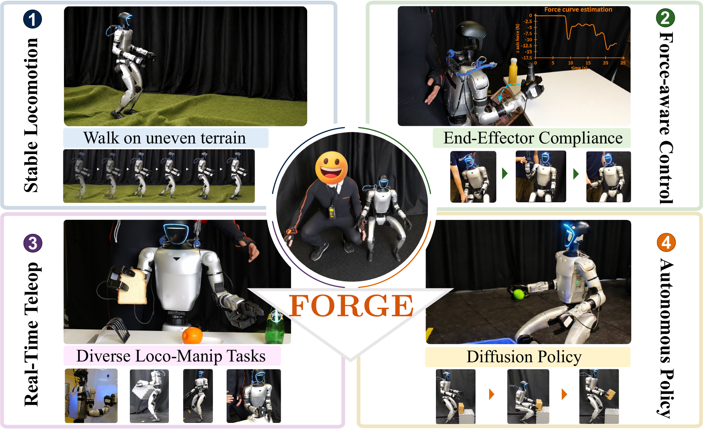

<h1 align="center">FORGE</h1>

<p align="center">
  <strong>Force-Aware Multi-Granularity Control for<br>Efficient Humanoid Loco-Manipulation</strong>
</p>

<p align="center">
  <a href="https://bb0928.github.io/forge/">Project Page</a> ·
  <a href="https://bb0928.github.io/forge/forge-paper.pdf">Paper</a> ·
  <a href="https://www.bilibili.com/video/BV1qkYa6zEx6/">Video</a> ·
  <a href="docs/README.md">Documentation</a>
</p>

<p align="center">
  <a href="https://github.com/mujocolab/mjlab"></a>
  <a href="docs/installation.md"></a>
  <a href="LICENSE"></a>
</p>

<p align="center">
  <a href="https://www.bilibili.com/video/BV1qkYa6zEx6/">
    
  </a>
</p>

<p align="center"><em>Whole-body loco-manipulation with FORGE. Click the figure to watch the project video.</em></p>

## Overview

**FORGE** studies humanoid loco-manipulation through a multi-granularity command
interface, connecting locomotion, end-effector tracking and contact interaction.
See our [paper](https://bb0928.github.io/forge/forge-paper.pdf) and
[project page](https://bb0928.github.io/forge/) for the method and experiments.

This repository provides the **mjlab implementation for G1 whole-body policy
training and simulation**. A single policy learns walking, height control and
upper-body target tracking from command and proprioceptive histories, producing
joint actions for the 29-DoF Unitree G1.

- **Whole-body coordination.** Grouped command masks and a temporal policy connect
  locomotion, squatting and upper-body tracking in one training framework.
- **Learning from scratch.** PPO training combines an upper-body curriculum,
  symmetry augmentation, exploration regularization and domain randomization,
  including independently sampled 0–2 kg hand payloads. No motion-capture dataset
  is required.
- **Interactive simulation.** A browser viewer exposes walking and height
  controls, upper-body target sampling, and target-versus-actual FK overlays.

[Installation](#installation) · [Training](#training) · [Playback](#playback) ·
[Documentation](#documentation) · [Citation](#citation)

## Installation

**Requirements:** Linux, Python 3.12, and an NVIDIA GPU. Run the following commands
from the repository root:

```bash
git clone --branch mjlab --single-branch https://github.com/bb0928/FORGE.git
cd FORGE

python3.12 -m venv .venv
source .venv/bin/activate
python -m pip install --upgrade pip
python -m pip install torch==2.7.1 torchvision==0.22.1 --index-url https://download.pytorch.org/whl/cu128
python -m pip install -r requirements.txt
```

Verify the environment:

```bash
python scripts/check_runtime.py
```

For setup details, see [Installation](docs/installation.md).

## Training

Train a whole-body policy from scratch:

```bash
CUDA_VISIBLE_DEVICES=0,1,2,3 python scripts/train.py
```

The default recipe uses **4 GPUs, 4,096 environments per GPU, 10,000 iterations**
and seed 7. Checkpoints and TensorBoard logs are saved to
`logs/forge-20260801-s7/`.

For a single-GPU run:

```bash
CUDA_VISIBLE_DEVICES=0 python scripts/train.py \
  --gpus 1 --num-envs 512 --iterations 10000 --run-name g1-single-gpu
```

Monitor training:

```bash
tensorboard --logdir logs
```

The [training guide](docs/training.md) covers the configuration, smoke test and
experiment options. The default recipe is in
[configs/milestone.json](configs/milestone.json).

## Playback

Visualize a trained policy by passing its checkpoint:

```bash
python scripts/play.py --checkpoint logs/forge-20260801-s7/model_9999.pt
```

Open **http://localhost:8080** to interact with the controller.

| Control | Function |
|---|---|
| Walking | Forward, lateral and turning velocity sliders |
| Height | Squatting and standing height commands |
| Upper-body curriculum | Upper-body target range |
| FK overlay | Target and actual wrist/elbow positions |

The viewer starts in manipulation mode. Uncheck `force manip (squat enabled)` to
use the walking sliders; leave it checked to adjust height.

For playback without a browser:

```bash
python scripts/play.py \
  --checkpoint logs/forge-20260801-s7/model_9999.pt --headless --steps 300
```

See [Playback](docs/playback.md) for the complete controls and remote viewing.

## Documentation

| Guide | Contents |
|---|---|
| [Installation](docs/installation.md) | Environment setup and troubleshooting |
| [Training](docs/training.md) | Configuration, resource options and outputs |
| [Playback](docs/playback.md) | Interactive controls and headless simulation |
| [Method and code](docs/method.md) | Policy architecture, observations and code structure |

## Citation

If you use FORGE in your research, please cite our work. The manuscript and its
BibTeX are available on the [project page](https://bb0928.github.io/forge/#bibtex).

## Acknowledgements

Our implementation builds on [mjlab](https://github.com/mujocolab/mjlab),
[MuJoCo Warp](https://github.com/google-deepmind/mujoco_warp) and
[RSL-RL](https://github.com/leggedrobotics/rsl_rl). Robot resources originate from
[Unitree](https://github.com/unitreerobotics/unitree_ros). We thank the authors and
maintainers for their contributions to the robotics community.

## License

FORGE contributions are licensed under [Apache-2.0](LICENSE). Third-party code
and robot resources retain their original licenses; see
[THIRD_PARTY_NOTICES.md](THIRD_PARTY_NOTICES.md).
