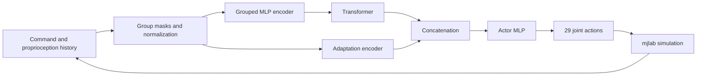

# Method and code

[Overview](../README.md) · [FORGE paper](https://bb0928.github.io/forge/forge-paper.pdf)

## Whole-body policy

The mjlab implementation learns one policy for all 29 controlled G1 joints.
Command groups and proprioception are assembled into a history with group masks,
then passed through an observation encoder and a Transformer. An adaptation
encoder supplies an additional latent representation to the actor.

The actor combines a 128-dimensional token with a 64-dimensional adaptation
latent. A privileged critic and auxiliary adaptation targets provide training
supervision. Joint actions are converted to position targets by mjlab using
per-joint scales and default offsets.

Upper-body targets come from forward kinematics of sampled joint configurations.
A curriculum expands their range as learning progresses. Height commands drive
squatting, while symmetry augmentation, a delayed pose guard and StdL2
regularization shape the learning process.

## Observation contract

| Tensor | Layout | Width |
|---|---|---|
| Actor input | 6 × 131 observation values + 6 × 11 group masks | 852 |
| Critic input | 156 observation values + 17 group masks | 173 |
| Actor output | Full-body joint action | 29 |
| Critic output | State value | 1 |

[obs_spec.py](../obs_spec.py) defines the observation groups;
[obs_builder.py](../obs_builder.py) constructs them and maintains history.

## Code structure

| Path | Responsibility |
|---|---|
| [scripts/train.py](../scripts/train.py) | Training launcher and run metadata |
| [scripts/play.py](../scripts/play.py) | Playback launcher |
| [configs/milestone.json](../configs/milestone.json) | Default training profile |
| [train_forge_base.py](../train_forge_base.py) | Environment, rewards, PPO configuration and training |
| [play_base.py](../play_base.py) | Viewer controls and headless simulation |
| [commands.py](../commands.py) | Command sampling, masks and FK targets |
| [rewards.py](../rewards.py) | Tracking and regularization objectives |
| [rl/base_actor_critic.py](../rl/base_actor_critic.py) | Actor, critic and adaptation network |
| [rl/forge_runner.py](../rl/forge_runner.py) | Learning loop and curriculum |
| [rl/std_l2_ppo.py](../rl/std_l2_ppo.py) | PPO with StdL2 regularization |
| [forge_symmetry_func.py](../forge_symmetry_func.py) | Mirror augmentation |
| [assets/](../assets/) | Robot model and meshes |
